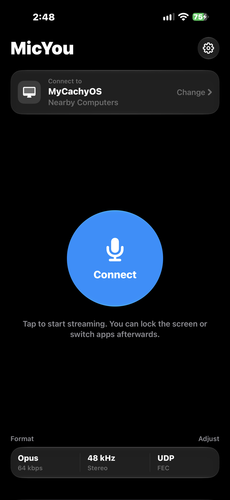
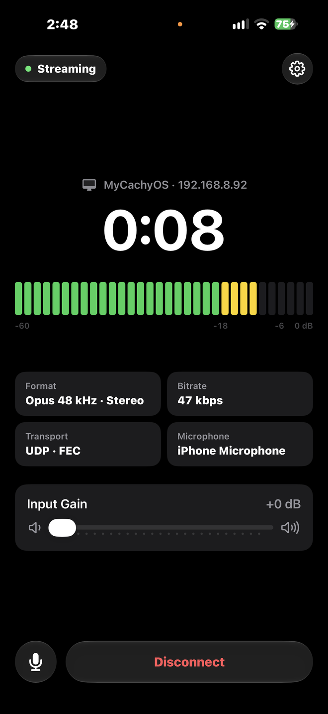
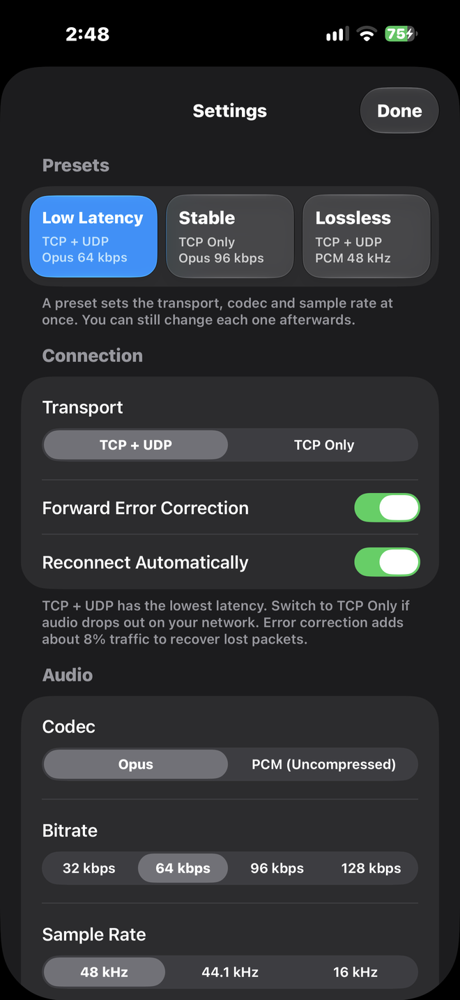
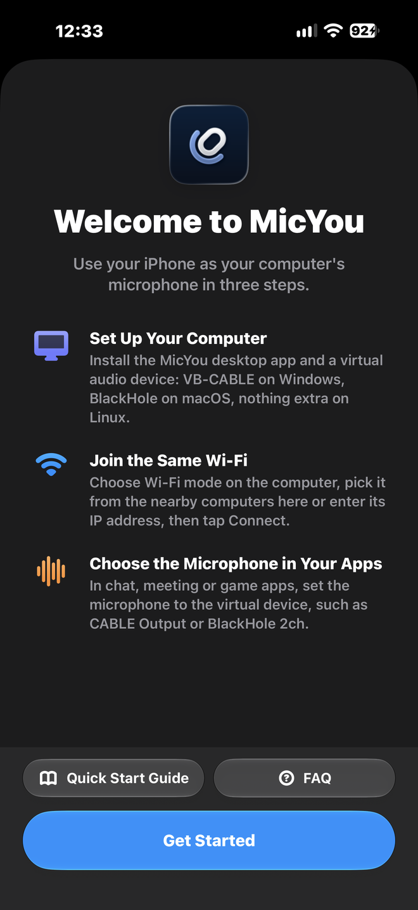
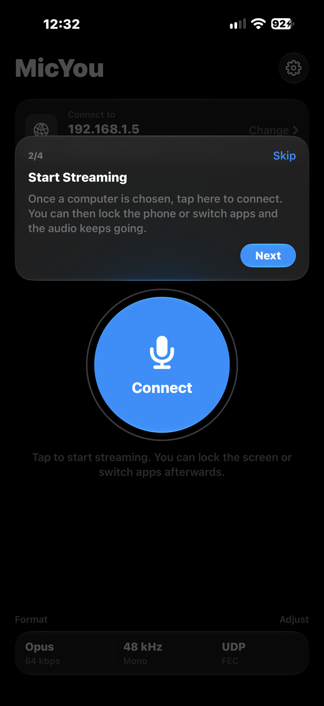
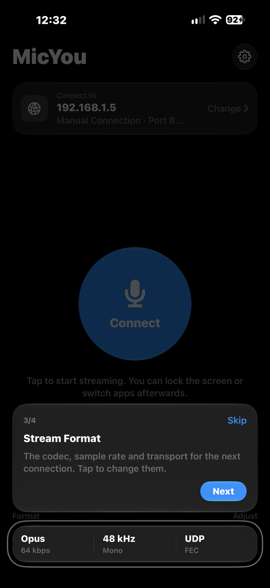
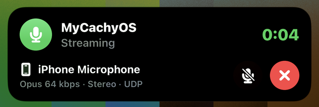
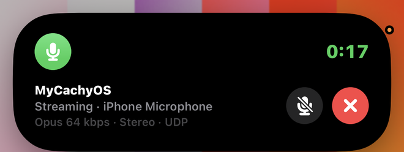
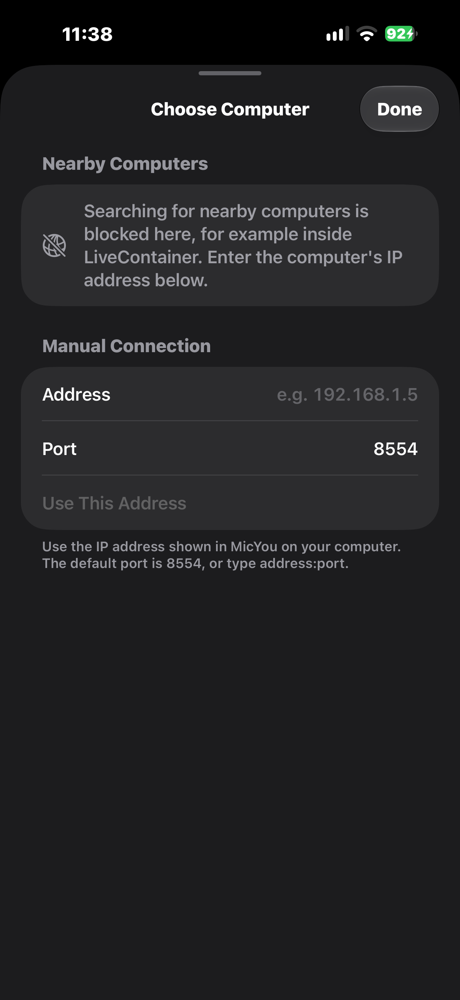

<div align="center">

  <h1>MicYou for iOS</h1>

  

  <br>
  <br>

  <a href="https://github.com/MicYou-Dev/MicYou-iOS/releases/latest"></a>
  
  <a href="LICENSE"></a>
  <a href="https://qm.qq.com/q/V16hPpWPKO"></a>
  <a href="https://t.me/MicYouChannel"></a>

  <p>把 iPhone 当作电脑麦克风使用的 iOS 客户端</p>

  配合 <a href="https://github.com/MicYou-Dev/MicYou">MicYou</a> 桌面端 2.x 使用 · SwiftUI · 局域网无线传输 · 支持锁屏与后台运行

</div>

## 功能

- 通过 Bonjour 自动搜索局域网内的电脑，也可以手动输入 IP（支持 `地址:端口` 格式）并保存常用地址；还可以用数据线通过 USB 连接（Windows 需安装 iTunes，Linux 需安装 usbmuxd）。
- 默认使用 TCP + UDP 传输，延迟最低；网络不稳时可切换为纯 TCP，或开启 UDP 前向纠错（每 12 包附加 1 个 XOR 校验包）。
- 支持 Opus（系统编码器）和 16 位 PCM 编码，可选 48 / 44.1 / 16 kHz 采样率、单声道或立体声。内置“低延迟”“稳定”“无损”三档预设，可以一键切换。
- 支持 0 到 +24 dB 的软件输入增益，内置防爆音限幅器；可按需开启系统人声处理（回声消除、降噪、自动增益）；开启后可在控制中心切换系统麦克风模式（如语音突显），App 内会显示当前模式。
- 可选择输入设备：底部、前置、后置麦克风，或耳机、USB、蓝牙麦克风，传输中也能直接切换。
- 传输时显示电脑端测得的往返延迟和丢包率。
- 与电脑端双向同步静音状态，也可开启“按住说话”。断线后支持自动重连（最多 6 次），重连期间后台录音不会中断；通话等占用麦克风结束后会自动恢复。
- 可设置打开 App 时自动连接；传输时可切换到黑屏模式，屏幕保持常亮但几乎不耗电。
- 支持锁屏与后台持续传输，可在锁屏实时活动和灵动岛查看连接状态、当前麦克风与音频格式，并直接静音或断开。
- 支持快捷指令和 `micyou://` URL。
- 首次启动配有欢迎页与首页操作引导，并提供官网快速开始与常见问题入口（可在“关于”页重新查看）。“关于”页可导出本次运行的日志，方便反馈问题。
- 提供简体中文、繁体中文和英文界面。

## 截图

| 首页 | 传输中 | 设置 |
| :---: | :---: | :---: |
|  |  |  |

| 欢迎页 | 引导：开始传输 | 引导：传输格式 |
| :---: | :---: | :---: |
|  |  |  |

| 锁屏实时活动 | 灵动岛 |
| :---: | :---: |
|  | <br> |

## 安装

需要 iOS 18.0 或更高版本，请在 [GitHub Releases](https://github.com/MicYou-Dev/MicYou-iOS/releases/latest) 下载：

| 文件 | 说明 |
| --- | --- |
| `MicYou-<版本>.ipa` | 完整版（未签名），可用 AltStore、SideStore、Sideloadly 或 xtool 签名安装 |
| `MicYou-<版本>-LiveContainer.ipa` | LiveContainer 专用版，去掉了小组件扩展，不支持实时活动和灵动岛 |
| `SHA256SUMS.txt` | 安装包的 SHA-256 校验值 |

电脑端请到 [MicYou Releases](https://github.com/MicYou-Dev/MicYou/releases) 下载。虚拟麦克风的配置方法见官网[快速开始指南](https://www.micyou.top/docs/quick-start)，IPA 侧载教程见[在 iOS 上安装](https://www.micyou.top/docs/how-to-install-in-ios)。

## 使用方法

1. 打开电脑上的 MicYou 桌面端，连接模式选 **Wi-Fi**，确保手机和电脑连在同一个局域网。
2. 打开手机 App，点顶部的电脑卡片，在“附近的电脑”里选中你的电脑。如果没搜到，可以下拉刷新，或者在下方“手动连接”里直接填 IP 地址。也可以用数据线连接电脑，电脑端选 **USB** 模式并开始，手机端选“USB 数据线”。
3. 点击主界面中间的“连接”。首次使用需要允许麦克风和本地网络权限。
4. 连上之后就可以锁屏或切到后台。界面上会显示传输时长、输入电平、编码格式和码率，也可以随时拖动滑块调整输入增益。
5. 在电脑的语音、游戏、直播或录音软件里，把麦克风输入设备选为 MicYou 配置好的虚拟麦克风。

受 iOS 限制，只能在应用处于前台时开始录音；开始传输后就可以正常锁屏或切到后台。

## URL Scheme

| URL | 作用 |
| --- | --- |
| `micyou://connect` | 连接上次使用的电脑 |
| `micyou://disconnect` | 断开连接 |
| `micyou://toggle` | 切换连接 / 断开 |
| `micyou://mute` / `micyou://unmute` / `micyou://toggle-mute` | 静音 / 取消静音 / 切换静音 |

如果“快捷指令”里搜不到 MicYou 的操作，可以用系统的“打开 URL”动作调用上面的链接。

## 常见问题

| 现象 | 解决办法 |
| --- | --- |
| 列表里找不到电脑 | 检查电脑端是否正在运行且没有开 Web 模式，确认手机和电脑在同一网段、路由器没开 AP 隔离。也可以直接手动输入电脑 IP。 |
| LiveContainer 里提示 NoAuth 或无法查找电脑 | LiveContainer 没有声明 MicYou 的 Bonjour 服务，系统会拦截局域网搜索。请在“手动连接”里输入电脑端显示的 IP 地址（输入框里的灰色示例不算已输入）。 |
| 提示电脑拒绝了连接 | 端口填错了，或者电脑端没在监听。默认端口是 `8554`。 |
| 声音断断续续 | 去设置里把传输方式改成“仅 TCP”，或者开启“前向纠错”。 |
| 声音太小 | 在设置或主界面调高“输入增益”，内置限幅器会防止爆音。 |
| 没有实时活动 | 检查系统设置里是否关掉了实时活动权限；另外 LiveContainer 专用包不包含小组件扩展。 |

更多问题可参考官网[常见问题](https://www.micyou.top/docs/faq)。

在 LiveContainer 中运行时，“选择电脑”页面会直接提示无法自动查找，并把光标定位到手动地址输入框：



## 构建与开发

项目用 Swift 6 和 [xtool](https://github.com/xtool-org/xtool) 构建，不需要完整的 Xcode 工程，在 Linux 和 macOS 上都可以编译签名。

- 界面用 SwiftUI 和 Observation；实时活动与灵动岛用 ActivityKit 和 WidgetKit，快捷指令用 App Intents。
- 音频采集基于 `AVAudioEngine`，重采样与系统 Opus 编码使用 `AVAudioConverter`，自带峰值限幅器。
- 网络层基于 `Network.framework`（`NWBrowser` 负责 Bonjour 发现，TCP 走控制信令，UDP 发音频）。
- `MicYouProtocol` 只依赖 Foundation，包含 protobuf 编解码、数据分帧和 XOR 前向纠错，可以直接在 Linux 上跑测试。
- `MicYouCore` 放不依赖 Apple 框架的应用逻辑（预设、重连策略、采样处理、电平表动态等），同样可以在 Linux 上测试。

配置好 Swift 6 和 xtool（`xtool setup`）后，常用命令如下：

```bash
# 编译、签名并安装到手机
xtool dev run

# 运行协议库与核心逻辑测试（支持 Linux）
swift test --package-path Packages/MicYouProtocol
swift test --package-path Packages/MicYouCore

# 检查简/繁/英三语本地化表
Tools/check-strings.py

# 生成去掉小组件扩展的 LiveContainer 专用包（xtool/MicYou-LiveContainer.ipa）
Tools/build-livecontainer.sh
```

`Tools/mock_receiver.py` 可以模拟桌面端：回应握手、发送心跳、打印控制消息，并把收到的 PCM 音频存成 WAV 文件，方便在没有桌面端时调试：

```bash
python3 Tools/mock_receiver.py --mdns --toggle-mute 5
```

### 目录结构

```text
Packages/MicYouProtocol   协议编解码、分帧、FEC、地址解析（纯 Foundation）
  Proto/network.proto     上游 protobuf 协议定义
Packages/MicYouCore       与系统框架无关的应用逻辑：选项与预设、重连策略、采样处理、电平表、输入偏好
Sources/MicYou            主应用源码
  App/                    入口、全局状态 AppModel、采集与会话桥接
  Model/                  持久化设置、传输与编码选项、预设、StreamConfig
  Audio/                  麦克风采集与输入选择、Opus 编码
  Network/                Bonjour 发现、TCP 控制通道、UDP 音频与会话
  Live/                   实时活动驱动、当前麦克风信息与可选输入
  Intents/                快捷指令
  Views/Home              主界面：待机、传输中、电平表、底部控制栏
  Views/Picker            选择电脑与手动连接
  Views/Settings          设置与关于
  Views/Common            液态玻璃样式、提示卡片、增益滑块、格式文案
Sources/MicYouShared      主应用与小组件共用：多语言 L10n、DeepLink、实时活动定义
Sources/MicYouWidget      实时活动与灵动岛扩展
Support/                  Info.plist 与三语本地化文件
Resources/AppIcon         液态玻璃图标源文件 MicYou.icon 与编译产物 Assets.car
Tools/                    模拟接收端脚本、LiveContainer 打包、本地化检查
docs/                     协议、架构与开发文档
```

详细文档：

- [docs/PROTOCOL.md](docs/PROTOCOL.md)：通信协议格式
- [docs/ARCHITECTURE.md](docs/ARCHITECTURE.md)：模块划分、数据流与线程模型
- [docs/DEVELOPMENT.md](docs/DEVELOPMENT.md)：xtool 踩坑记录、CI 发布与真机调试

## 已知限制

- xtool 无法运行 Xcode 的 App Intents 元数据处理器，系统“快捷指令”里可能看不到本应用的操作（可用 `micyou://` URL 代替）。
- 不支持 USB 连接模式。

## 交流

- QQ 群：[995452107](https://qm.qq.com/q/V16hPpWPKO)
- Telegram 频道：[@MicYouChannel](https://t.me/MicYouChannel)

## 致谢

- [MicYou](https://github.com/MicYou-Dev/MicYou)：由 LanRhyme 及贡献者开发，本项目的通信协议与客户端行为移植自它的 Android 端。
- [MicYou-iOS (`v2` 分支)](https://github.com/MicYou-Dev/MicYou-iOS/tree/v2)：由 herbrine8403 及贡献者开发，本项目的部分界面文案与设置布局参考了该分支。
- 液态玻璃图标来自 MicYou [#350](https://github.com/MicYou-Dev/MicYou/pull/350)，作者 WhatDamon。
- [MicWisp](https://github.com/TimmySheep/MicWisp)：由 TimmySheep 开发，iOS 音频会话配置参考了该项目。
- [xtool](https://github.com/xtool-org/xtool)：让 iOS 应用可以在 Linux 上编译和签名。

## 许可

采用 GPL-3.0-or-later 许可证，详见 [LICENSE](LICENSE) 与 [NOTICE](NOTICE)。
